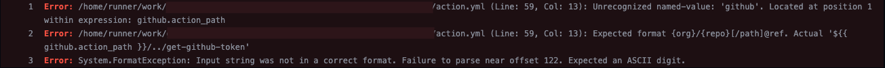

import Figure from "../../../components/blog/Figure.astro";
import Aside from "../../../components/blog/Aside.astro";

When writing a GitHub Actions composite action, how do you reference a sibling action that exists in the same repo?

import SiblignActionsDiagram from "./sibling-actions.excalidraw.svg?raw";

<Figure>
  <Fragment set:html={SiblignActionsDiagram} />
</Figure>

Turns out that this is a deliciously tricky question...

## Pinned refs

We could of course just reference the sibling action directly, just like the caller would.

```yaml {9}
# release/action.yml
name: "release"
description: ""

runs:
  using: "composite"
  steps:
    - name: Get GitHub token to GitOps
      uses: my-org/actions/get-github-token@v1
      with:
        repo: my-org/gitops-repo
        permissions: "contents:write"
    
    # ...
```

This creates a problem though: how do we update the `@...` ref when our code changes? The caller should be able to trust that pinning to `@v1` means that _every_ action in the call chain is pinned to `v1` - or even trust that pinning to a specific commit SHA would pin _every_ action in the call chain to that commit SHA.

But the `@ref` value in GitHub Actions can't be dynamic. You can't write `uses: my-org/actions/get-github-token@${{ github.actions_ref }}` to use the same ref as you were called with. The reference must be statically written in the file...

We _could_ create a relatively complex system of updating the references in every action every time we publish changes. We'd have to update them to the commit SHA though, since we'd otherwise pull the rug out under users who want to avoid [mutable references](https://docs.zizmor.sh/audits/#unpinned-uses) - so we'd have to commit our actual code changes in one commit, and then have a CI job that goes through and updates every sibling reference to the commit SHA of that commit.

That sounds like a hell of a process. Let's explore our other options.

## Relative paths

We could just use relative paths, like `uses: ./path/to/sibling`.

```yaml {9}
# release/action.yml
name: "release"
description: ""

runs:
  using: "composite"
  steps:
    - name: Get GitHub token to GitOps
      uses: ./../get-github-token  # just reference it relative to the current action
      with:
        repo: my-org/gitops-repo
        permissions: "contents:write"
    
    # ...
```

The problem is that relative `uses:` references in GitHub Actions require the code to be checked out to the file system before they work. The runner follows a process similar to

1. Calculate the path relative to `$GITHUB_WORKSPACE`
1. Check if there is an `action.yml` already there on the GHA runner's file system
1. If there is, run it. Otherwise throw an error

This means that we need to [check out](https://github.com/actions/checkout) our `my-org/actions` repository first, to a well-known location relative to `$GITHUB_WORKSPACE`, and _then_ we can reference it using relative paths. If we don't check out the code to the file system first then the runner can't find the action.


Of course that's relatively easy, we just have to add it to the first action in the chain:

```yaml ins={8-12} {15}
# release/action.yml
name: "release"
description: ""

runs:
  using: "composite"
  steps:
    - uses: actions/checkout@v5
      with:
        repository: ${{ github.action_repository }}
        ref: ${{ github.action_ref }}
        path: my-actions-repo

    - name: Get GitHub token to GitOps
      uses: ./my-actions-repo/get-github-token # ref to the checked out path
      with:
        repo: my-org/gitops-repo
        permissions: "contents:write"
    
    # ...
```

But... `github.action_repository` and `github.action_ref` [don't work in composite actions](https://github.com/actions/runner/issues/2473) 😎 There [are workarounds](https://github.com/actions/runner/issues/2473#issuecomment-1776131532), but they let users mess with it and are very opaque - and they _still_ break if the action is called using a relative ref (e.g. from a test workflow in your actions repository).

<Aside data-up>There's also a few other issues with writing files to `$GITHUB_WORKSPACE` (risk of overwriting user files, have to clean up after ourselves, requires redownloading the repo, etc.) but those we can work around</Aside>

Still, this approach somewhat works. We'll need to add a cleanup step at the end, but hey! This is GitHub Actions we're talking about, it's full of dirty half-working tricks.

```yaml ins={5-9} {16-17}
# release/action.yml
name: "release"
description: ""

inputs:
  action_ref: # https://github.com/actions/runner/issues/2473
    default: ${{ github.action_ref }}
  action_repository: # https://github.com/actions/runner/issues/2473
    default: ${{ github.action_repository }}

runs:
  using: "composite"
  steps:
    - uses: actions/checkout@v5
      with:
        repository: ${{ inputs.action_repository }}
        ref: ${{ inputs.action_ref }}
        path: my-actions-repo

    - name: Get GitHub token to GitOps
      uses: ./my-actions-repo/get-github-token # ref to the checked out path
      with:
        repo: my-org/gitops-repo
        permissions: "contents:write"
    
    # ...
```

At the end of the day the only thing that made me switch away from this approach was that I could no longer write test workflows for my actions. So let's get even _more_ creative:

## Use the `github.action_path`

As it turns out, the repository that the current action is running is actually already checked out on the file system, and you can get a reference to it using `${{ github.action_path }}`. If we use _that_ in place of the relative path, then we should have an easy way to reference sibling actions:

```yaml {9}
# release/action.yml
name: "release"
description: ""

runs:
  using: "composite"
  steps:
    - name: Get GitHub token to GitOps
      uses: ${{ github.action_path }}/../get-github-token  # reference the files already checked out on disk
      with:
        repo: my-org/gitops-repo
        permissions: "contents:write"
    
    # ...
```

But of course GitHub couldn't let it be that easy. As mentioned earlier, the `uses:` reference must be entirely static, otherwise the runner throws an error.



With the knowledge we have from the previous sections, that's not enough to stop us though, is it. We know that, in order to use a relative `uses:` reference what we need is:

- The code already checked out on the file system.
- A know path to the action, relative to `$GITHUB_WORKSPACE`

The former we have. The latter we can create. Hold on to your horses now, because things are getting dirty.

```yaml ins={8-18} {21}
# release/action.yml
name: "release"
description: ""

runs:
  using: "composite"
  steps:
    - name: Set up sibling symlink
      shell: bash
      run: |
        PATH_TO_CHECKED_OUT_FILES=$(realpath "${ACTION_PATH}/../")
        TARGET_DIRECTORY=$(realpath "${WORKSPACE_PATH}/..")
        TARGET_PATH="${ROOT_DIR}/symlink-to-my-actions-repo"
        echo "[command]ln -fs '${PATH_TO_CHECKED_OUT_FILES}' '${TARGET_PATH}'"
        ln -fs "${PATH_TO_CHECKED_OUT_FILES}" "${TARGET_PATH}"
      env:
        WORKSPACE_PATH: "${{ github.workspace }}"
        ACTION_PATH: "${{ github.action_path }}"

    - name: Get GitHub token to GitOps
      uses: ./../symlink-to-my-actions-repo/get-github-token # known path to symlink to ${{ github.action_path }}
      with:
        repo: my-org/gitops-repo
        permissions: "contents:write"
    
    # ...
```

We create a symlink in a known location - outside of `$GITHUB_WORKSPACE` so we don't clobber any user files - and just like that we have a known, static path to a dynamic `${{ github.action_path }}`.

When the GitHub Actions runner encounters this `uses:` reference it checks its file system and... it just works? We have to do a few things that aren't in the above example of course - cleaning up after ourselves, extracting the logic into an action we can call, etc. - but... it works?

This hacky hacky workaround has a few properties that we like:

- The calling workflow gets to decide what reference we should use throughout the call chain. We respect commit SHA pinning just as much as we do anything else.
- There are no restrictions on _how_ the action can be called. It can be a relative path in a test workflow, or a pinned reference in a remote repo.
- The ref resolution happens on runtime. We don't need to create new commits to update a static `uses: ...@...` every time we touch the code

But of course

- It's a big old ugly hack. It's terrible and it's shameful, and I feel bad for having to do something this abusive just to get sibling references working.
- It's incredibly opaque. Even when wrapped up in a well-documented action that does all of this, it's still highly unlikely that anyone will ever maintain this crapshoot of a solution if you get hit by a bus.

## Conclusion

I don't know if there's much of anything to take away from this. I wouldn't recommend actually using the last solution presented, simply because of how hacky it is. At the same time, the other solutions have downsides that aren't very workable.

This whole blog post has mostly been a long rant ;) GitHub Actions isn't known for its robustness, and this is one of the cases where you think there _must_ be a simple solution, but end up running into problem after problem as poor design choices from GitHub stand in your way.

If there's one thing to take away from this, it's probably that keeping your actions in a monorepo comes with some pains. Keeping your actions in separate repos... also comes with some pains. I don't have a good closer.